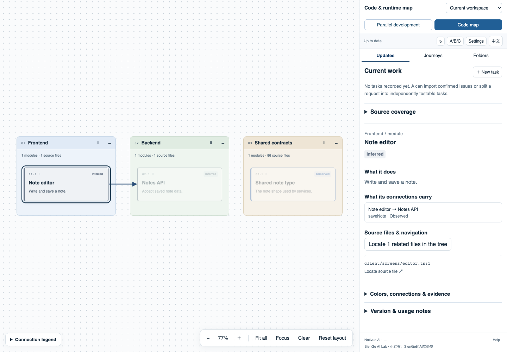

# Nativue AI

**Your canvas for AI-native development.**

English · [简体中文](README.zh-CN.md)

Understand a codebase, coordinate A/B/C agents, and see exactly which version has passed review. Nativue combines a reusable Skill with a local CLI and a browser canvas. It works with an existing repository; it does not prescribe your framework or model.

By **SienGe AI Lab** · Xiaohongshu / 小红书: **SienGe的AI实验室**


## Start locally

This is a source-install release candidate. A public npm release and hosted service are not required. Install Node.js **24 or newer** and Git, then run these commands from your cloned Nativue repository:

```sh
npm install
npm run build
node bin/nativue.js init /path/to/workspace
node bin/nativue.js serve /path/to/workspace
```

Open the local address printed by `serve`. Initialization asks for a language, AI tool, collaboration mode, role models, scan scope, and optional remote synchronization. It indexes files first; an agent then explains architecture with source evidence. A directory grouping is not a verified architecture.

Tell your agent:

> Load `skills/nativue/SKILL.md` from this checkout. Initialize Nativue for my selected workspace, inspect its development instructions, and generate the first architecture analysis. Ask before choosing among multiple repositories. Then open the canvas.

Install the included Skill with `install-skill` after checking `node bin/nativue.js --help`, or load its entrypoint directly. The Skill stays separate from your existing repository instructions.

## What you see

- **Architecture:** modules, dependencies, source evidence, and confidence labels. Drag, zoom, collapse, and inspect connections.
- **Journeys:** trace a user flow through relevant modules, with unknown steps identified explicitly.
- **Parallel tasks:** priorities, dependencies, ownership, rework, independent review, integration, and user acceptance.
- **File location:** selecting a source reference reveals and scrolls the right-hand file tree to that file, with navigation between multiple matches.
- **Versions:** local working state and an optional remote branch have separate provenance. A newer remote graph never implies that local code was updated.



The preview uses a fictional project. [中文界面预览](assets/canvas-preview.zh.png).

## Two ways to work

| Mode | How it works | Best fit |
| --- | --- | --- |
| Separate conversations | Open A, B, and C yourself; exchange versioned task handoff packets | Broad tool compatibility and close control |
| A starts subagents | A uses the host's available subagent tools to create B/C with separate contexts | A larger batch of independent tasks |

**A** plans and coordinates. **B** implements and self-tests. **C** independently checks the exact submitted commit. Failed work returns to B. Passing individual tasks are integrated, reviewed again by C at the integration commit, and handed to the user for a final test. C cannot approve on the user's behalf.

Models are user-configured by role. Nativue does not switch the current conversation's model. No host's subagent API is assumed to exist in another host. See [the workflow](docs/workflow.md).

## Compatibility, honestly

| Tool | Included integration | Automatic agents | Live host verification |
| --- | --- | --- | --- |
| Codex | Generic Skill, local commands, A/B/C handoffs | Requires exposed host subagent capability | Background analysis bridge only: passed 2026-10-18 |
| Claude Code | Generic Skill, local commands, A/B/C handoffs | Requires exposed host subagent capability | Not yet recorded |
| WorkBuddy | Generic Skill and manual A/B/C workflow | Not claimed without a verified interface | Not yet recorded |

“Included” means the repository contains the instructions and integration paths; it does not mean all three products have been exercised end to end. A real Codex CLI background analysis passed on a fictional two-file TypeScript repository; manual A/B/C and automatic subagent delivery remain unverified in the hosts. The local test suite and host verification are separate. [Claude Code documents Skills](https://code.claude.com/docs/en/skills), and [WorkBuddy documents Skill plugins](https://www.workbuddy.cn/docs/workbuddy/Plugins); these are not evidence that Nativue's automatic scheduling has been tested. See [setup, exact tested versions and limits](docs/compatibility.md).

## Staying current

Keep `serve` running to reconcile source changes and task state even when the browser closes. The service stops when its process exits; no system service is installed. It coalesces file changes, preserves valid previous analysis after a failure, and labels pending or stale results.

Semantic analysis uses a configured, explicitly enabled command adapter. `configure-runner codex` or `configure-runner claude` enables the included host CLI bridge using your account and model usage. The Codex bridge has one recorded live fixture test; the Claude bridge remains unverified. Without one, Nativue queues an analysis packet for an interactive agent. It does not claim that refreshing a file index refreshed the architecture. Configurable intervals and daily call limits control repeat analysis. See [operation and analysis](docs/operation.md).

Remote sync is **opt-in**. This candidate supports public GitHub HTTPS sources; authenticated private remote synchronization is not yet supported. Local private repositories can still be scanned. Nativue analyzes a selected remote branch in an isolated cache. It does not pull into your worktree, change branches, merge, or publish a graph. Local tasks work without GitHub. `issues` imports open public Issues as pending tasks, reading exact P0/P1/P2 labels and using P2 otherwise; custom label mappings are not yet implemented. Issue updates, pushes, and publication require their own authorization.

## Local data and trust

State, logs, caches, and local configuration live in `.nativue/`, which must stay ignored. Scans exclude common dependencies, generated artifacts, credentials, and runtime data; inspect exclusions for your project. Initialization does not execute target repository scripts or traverse symlinks outside the selected scope. An agent or command adapter may send code to its configured model provider under that provider's settings. Nativue itself does not provide a cloud upload service.

Use fictional examples when reporting bugs. See [contributing](CONTRIBUTING.md), [release checks](docs/RELEASE.md), and [MIT license](LICENSE).
