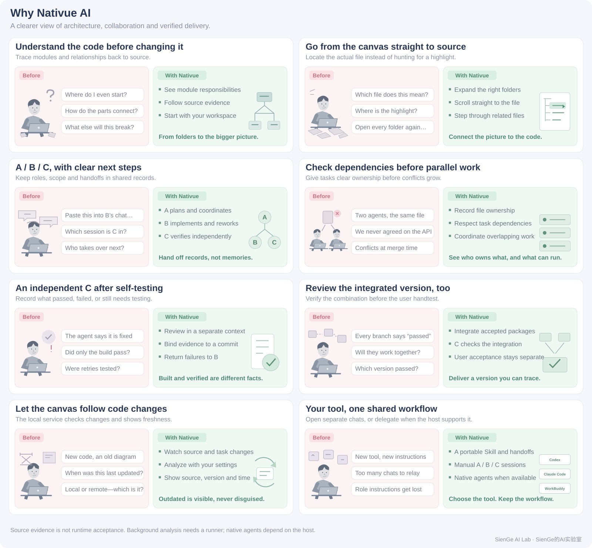
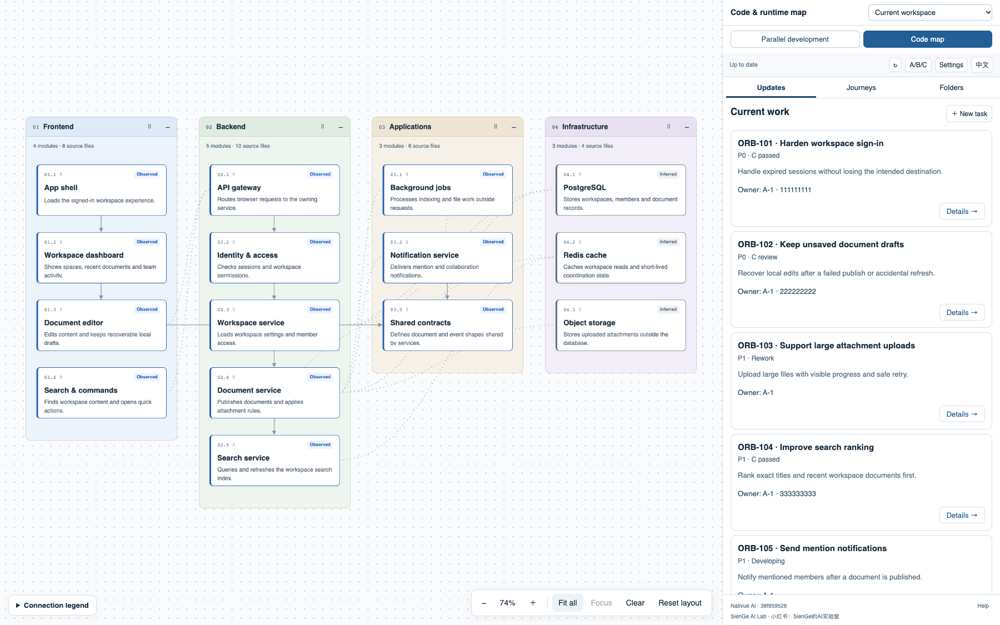
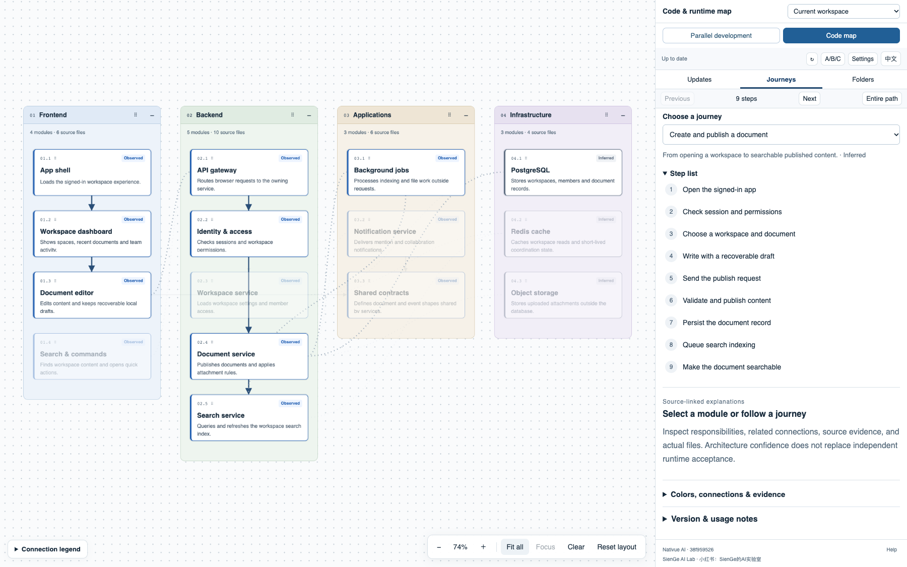
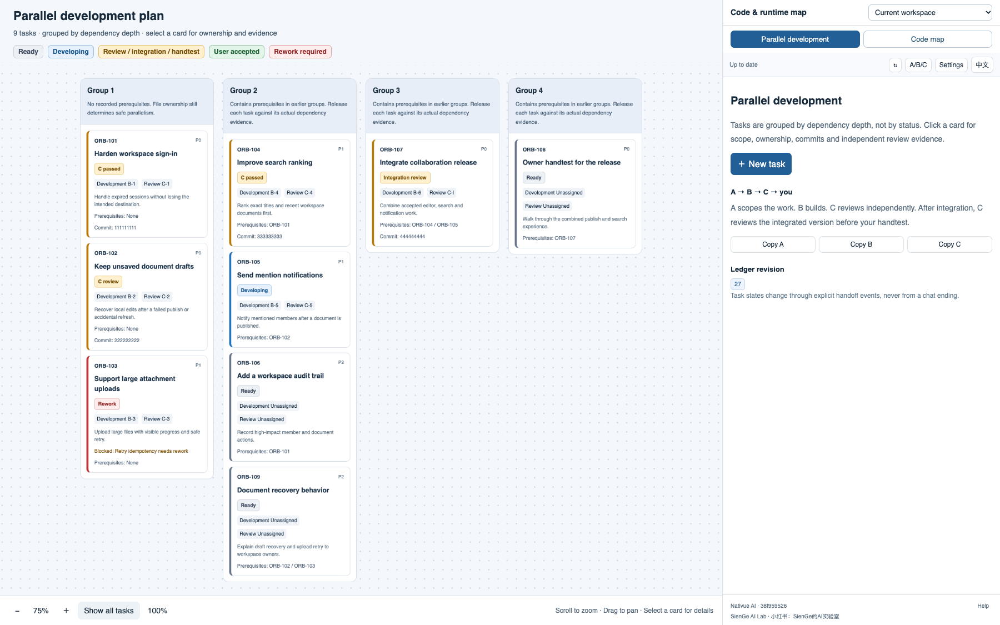
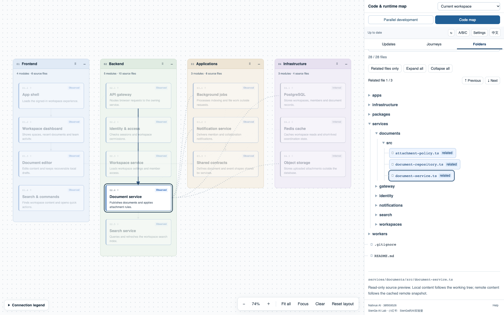
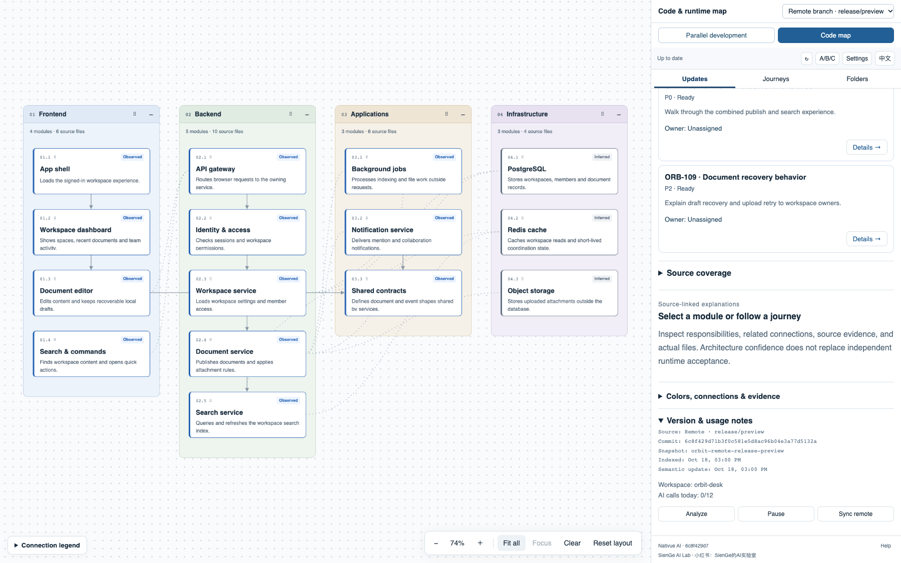

# Nativue AI

**Your canvas for AI-native development.**

English · [简体中文](README.zh-CN.md)

**A development canvas for non-technical vibe coders managing complex software projects.**

When an AI-built project grows toward production, features multiply, modules depend on one another, and several agents may work at once. The challenge grows from getting code written to **keeping the whole project in view, keeping AI on track, and moving work forward.**

Nativue brings architecture, user flows and parallel development progress into one canvas. Keep making product decisions in natural language: use the map to discuss relationships and scope, then manage delivery through A/B/C roles and independent review. You can oversee the project without first reading every line of its implementation.

By **SienGe AI Lab** · Xiaohongshu / 小红书: **SienGe的AI实验室**

## The starting point: a growing project, a shrinking sense of control

Nativue grew out of the creator’s AI development experience, shared on Xiaohongshu. This account is adapted from that story:

> I have no coding background, but I was using AI to build a complex project with production-grade software as the goal. As development progressed, agents misunderstood requirements, changes needed repeated rework, and it became harder to tell where the project stood.
>
> As a frequent Figma flowchart user, I asked AI to build an architecture canvas. I could see what each module did, how the parts communicated, and which modules a user journey passed through. I finally had a shared map to discuss with the agent.
>
> Then I separated the agents into A, B and C. A discussed interactions with me and split the work. B implemented, with independent tasks running in parallel where possible. C reviewed independently and returned failed work to B. The integrated version went through another review before my own handtest.

That is the workflow Nativue supports: **use architecture to keep the big picture and agree on scope; use clear roles and a parallel view to manage development progress.** The map helps you ask specific questions and check whether changes match your intent. Independent verification and your final judgment remain part of the process.

It is particularly useful when a project grows beyond a small prototype into multiple modules, repeated iterations and changes that must work together.



## Start locally

This is a source-install release candidate. A public npm release and hosted service are not required. Install Node.js **24 or newer** and Git, then run these commands from your cloned Nativue repository:

```sh
npm install
npm run build
node bin/nativue.js init /path/to/workspace
node bin/nativue.js serve /path/to/workspace
```

Open the local address printed by `serve`. Initialization asks for a language, AI tool, collaboration mode, role models, scan scope, and optional remote synchronization. It indexes files first; an agent then explains architecture with source evidence. A directory grouping is not a verified architecture.

Tell your agent:

> Load `skills/nativue/SKILL.md` from this checkout. Initialize Nativue for my selected workspace, inspect its development instructions, and generate the first architecture analysis. Ask before choosing among multiple repositories. Then open the canvas.

Install the included Skill with `install-skill` after checking `node bin/nativue.js --help`, or load its entrypoint directly. The Skill stays separate from your existing repository instructions.

## What you see

The five screenshots below come from the same Nativue interface and use a fictional team knowledge product called **Orbit Desk**. The example contains 15 modules, 18 module relationships, three user journeys and nine parallel tasks. Its paths, tasks and commit versions are demonstration data and do not represent a real repository.

### 1. Architecture: see the system and the change boundary

Modules are grouped into frontend, backend, application services and infrastructure. Connections show how the parts relate. The sidebar leads from current work to module responsibilities and source evidence. The canvas supports dragging, zooming and collapsing.



### 2. Journeys: trace one real action through the system

Choose a journey such as “Create and publish a document” to highlight its modules and read every step in order. Inferred paths remain visibly labeled and never substitute for independent runtime acceptance.



### 3. Parallel tasks: coordinate A, B and C around dependencies

Tasks are grouped by dependency depth. Each card exposes priority, developer, reviewer, prerequisites and current stage. Development, self-testing, independent C review, integration review and the user's handtest stay distinct.



### 4. File location: move from a module to the exact source file

Selecting a source reference expands its parent directories, scrolls the right-hand tree to the file and focuses the exact leaf. When a module owns several files, the controls step through each match.



### 5. Source versions: know which code the canvas explains

The local workspace and optional remote branch retain separate source, branch, commit, snapshot and update details. A newer remote map only means the remote snapshot changed; it never implies that local code was updated.



[查看同一示例的中文截图](README.zh-CN.md#画布里有什么).

## Two ways to work

| Mode | How it works | Best fit |
| --- | --- | --- |
| Separate conversations | Open A, B, and C yourself; exchange versioned task handoff packets | Broad tool compatibility and close control |
| A starts subagents | A uses the host's available subagent tools to create B/C with separate contexts | A larger batch of independent tasks |

**A** plans and coordinates. **B** implements and self-tests. **C** independently checks the exact submitted commit. Failed work returns to B. Passing individual tasks are integrated, reviewed again by C at the integration commit, and handed to the user for a final test. C cannot approve on the user's behalf.

Models are user-configured by role. Nativue does not switch the current conversation's model. No host's subagent API is assumed to exist in another host. See [the workflow](docs/workflow.md).

## Compatibility, honestly

| Tool | Included integration | Automatic agents | Live host verification |
| --- | --- | --- | --- |
| Codex | Generic Skill, local commands, A/B/C handoffs | Requires exposed host subagent capability | Background analysis bridge only: passed 2026-10-18 |
| Claude Code | Generic Skill, local commands, A/B/C handoffs | Requires exposed host subagent capability | Not yet recorded |
| WorkBuddy | Generic Skill and manual A/B/C workflow | Not claimed without a verified interface | Not yet recorded |

“Included” means the repository contains the instructions and integration paths; it does not mean all three products have been exercised end to end. A real Codex CLI background analysis passed on a fictional two-file TypeScript repository; manual A/B/C and automatic subagent delivery remain unverified in the hosts. The local test suite and host verification are separate. [Claude Code documents Skills](https://code.claude.com/docs/en/skills), and [WorkBuddy documents Skill plugins](https://www.workbuddy.cn/docs/workbuddy/Plugins); these are not evidence that Nativue's automatic scheduling has been tested. See [setup, exact tested versions and limits](docs/compatibility.md).

## Staying current

Keep `serve` running to reconcile source changes and task state even when the browser closes. The service stops when its process exits; no system service is installed. It coalesces file changes, preserves valid previous analysis after a failure, and labels pending or stale results.

Semantic analysis uses a configured, explicitly enabled command adapter. `configure-runner codex` or `configure-runner claude` enables the included host CLI bridge using your account and model usage. The Codex bridge has one recorded live fixture test; the Claude bridge remains unverified. Without one, Nativue queues an analysis packet for an interactive agent. It does not claim that refreshing a file index refreshed the architecture. Configurable intervals and daily call limits control repeat analysis. See [operation and analysis](docs/operation.md).

Remote sync is **opt-in**. This candidate supports public GitHub HTTPS sources; authenticated private remote synchronization is not yet supported. Local private repositories can still be scanned. Nativue analyzes a selected remote branch in an isolated cache. It does not pull into your worktree, change branches, merge, or publish a graph. Local tasks work without GitHub. `issues` imports open public Issues as pending tasks, reading exact P0/P1/P2 labels and using P2 otherwise; custom label mappings are not yet implemented. Issue updates, pushes, and publication require their own authorization.

## Local data and trust

State, logs, caches, and local configuration live in `.nativue/`, which must stay ignored. Scans exclude common dependencies, generated artifacts, credentials, and runtime data; inspect exclusions for your project. Initialization does not execute target repository scripts or traverse symlinks outside the selected scope. An agent or command adapter may send code to its configured model provider under that provider's settings. Nativue itself does not provide a cloud upload service.

Use fictional examples when reporting bugs. See [contributing](CONTRIBUTING.md), [release checks](docs/RELEASE.md), and [MIT license](LICENSE).
