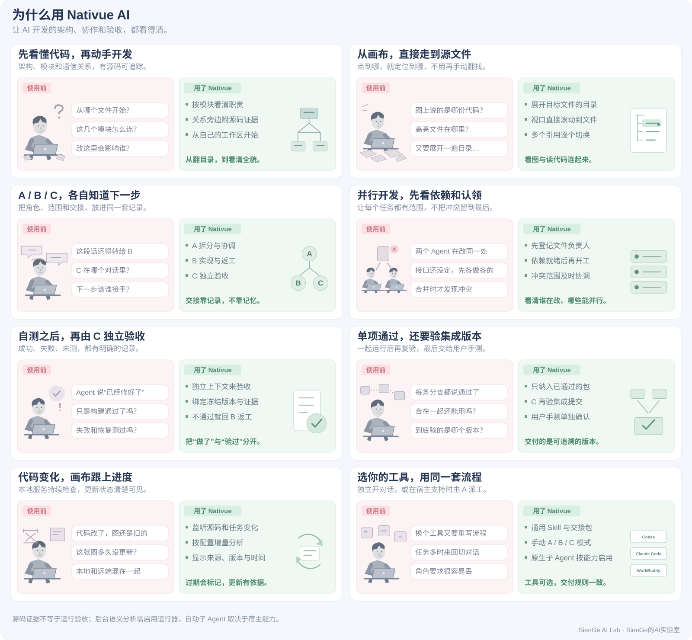
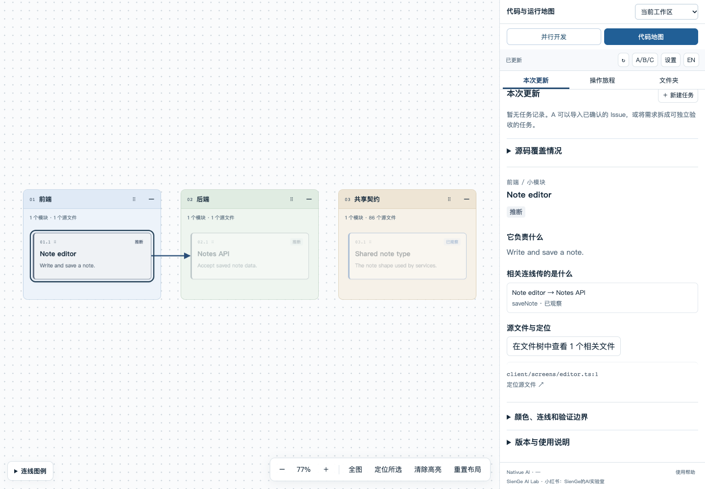

# Nativue AI

**Your canvas for AI-native development.**

[English](README.md) · 简体中文

看清代码架构，协同 AI 开发。Nativue 将可复用的 Skill、本地 CLI 和浏览器画布放在一起，让你理解现有代码库、安排 A/B/C 分工，并看到哪个版本真正通过了验收。语言、框架和角色模型由项目选择。

发行团队：**SienGe AI Lab** · 小红书：**SienGe的AI实验室**



## 本地开始

当前是源码安装候选版，无需 npm 正式发布或云端部署。安装 **Node.js 24 及以上**和 Git，在克隆后的 Nativue 目录运行：

```sh
npm install
npm run build
node bin/nativue.js init /path/to/workspace
node bin/nativue.js serve /path/to/workspace
```

打开 `serve` 输出的本地地址。初始化选择语言、AI 工具、协作模式、角色模型、扫描范围，以及是否开启远端同步。先索引实际文件，再由 Agent 提供带源码证据的架构解释；目录分组不代表架构已经验证。

可以把这句话交给 Agent：

> 读取当前 Nativue 仓库的 `skills/nativue/SKILL.md`。为我选择的工作区初始化，先读取开发规范，再生成第一版架构分析。如果发现多个仓库，先让我选择范围，然后打开画布。

通过 `node bin/nativue.js --help` 查看 `install-skill` 的安装参数，也可以直接加载 Skill 入口。它独立于项目已有规范，不覆盖原有指令文件。

## 画布里有什么

- **架构图**：模块、依赖、源码证据和可信程度；支持拖动、缩放、折叠及关系查看。
- **用户旅程**：沿实际使用流程查看经过哪些模块，明确标出未核实的步骤。
- **并行任务**：优先级、依赖、认领、返工、独立验收、集成和用户确认。
- **文件定位**：点击源码引用后，右侧文件树展开父目录并直接滚动到目标文件；多个匹配可以逐个切换。
- **来源版本**：本地工作区和可选的远端分支分别显示版本；远端图更新不代表本地代码已更新。



预览使用虚构项目。[English preview](assets/canvas-preview.en.png)。

## 两种协作方式

| 模式 | 使用方式 | 适用场景 |
| --- | --- | --- |
| 独立对话 | 自己打开 A、B、C，用带版本的任务交接包接续 | 兼容更多工具，需要细致把控 |
| A 自动调度 | A 使用宿主提供的子 Agent 能力创建独立的 B/C 上下文 | 单批任务较多、可并行开发 |

**A** 确认需求、拆分和协调；**B** 开发、自测及返工；**C** 独立验收 B 提交的准确版本。单项通过后集成，再由 C 验收集成版本，最后交给用户手测。C 不能代用户签署通过。

模型按角色由用户配置；Nativue 无法自行切换当前对话模型，也不把某个工具的子 Agent 接口当成其他工具的接口。详见[协作流程](docs/workflow.md)。

## 兼容范围与验证状态

| 工具 | 已提供内容 | 自动子 Agent | 宿主实测 |
| --- | --- | --- | --- |
| Codex | 通用 Skill、本地命令、A/B/C 交接 | 需要当前宿主暴露相应能力 | 仅后台分析桥接：2026-10-18 通过 |
| Claude Code | 通用 Skill、本地命令、A/B/C 交接 | 需要当前宿主暴露相应能力 | 尚无记录 |
| WorkBuddy | 通用 Skill、手动 A/B/C 流程 | 未验证接口前不宣称支持 | 尚无记录 |

“已提供”表示仓库包含对应指令及接入路径，不表示已在三个产品里全部运行通过。真实 Codex CLI 已对虚构的双文件 TypeScript 仓库完成后台分析；宿主内手动 A/B/C 与自动子 Agent 交付仍未验证。本地测试和宿主验证分别记录。[Claude Code 官方支持 Skills](https://code.claude.com/docs/en/skills)，[WorkBuddy 官方支持 Skill 插件](https://www.workbuddy.cn/docs/workbuddy/Plugins)；这不代表 Nativue 自动调度已完成实测。详见[接入说明、实测版本与能力边界](docs/compatibility.md)。

## 自动更新

`serve` 运行时持续检查文件和任务变化，网页关闭后仍可继续；服务进程退出即停止，不安装系统常驻任务。连续修改会合并处理，分析失败保留上一有效图，并显示待分析或已过期。

语义分析通过用户明确启用的命令适配器执行；`configure-runner codex` 或 `configure-runner claude` 可配置随附的宿主 CLI 桥接，使用你的账户及模型额度。Codex 桥接已有一次真实虚构仓库测试记录，Claude 桥接尚未实测。没有适配器时生成分析包，交给交互式 Agent 处理。刷新文件索引不会被标为架构分析完成。更新间隔和每日调用上限可配置，详见[运行与分析](docs/operation.md)。

远端同步在初始化时**自行选择开启**。本候选版支持公开的 GitHub HTTPS 来源，暂不支持需要认证的私有远端同步；本地私有仓库仍可正常扫描。工具在独立缓存中分析选定分支，不对工作区执行 pull、切分支或合并，也不会公开生成的图。没有 GitHub 也能使用本地任务。`issues` 将公开仓库未关闭的 Issue 导入为待办，识别 P0/P1/P2 标签，其他默认 P2；暂未实现自定义标签映射。远端评论、Issue 关闭、Push 和发布需要相应授权。

## 本地数据与隐私

状态、日志、缓存和本地配置存于 `.nativue/`，应始终排除在 Git 之外。扫描默认排除常见依赖、构建产物、凭证和运行数据；请检查是否符合你的项目。初始化不执行目标仓库的脚本，也不通过符号链接读取选定范围之外的文件。Agent 或命令适配器可能按配置将代码发往模型服务，适用该服务的数据设置；Nativue 本身不提供云端上传服务。

反馈问题请使用虚构示例。参见[贡献说明](CONTRIBUTING.md)、[发行检查](docs/RELEASE.md)及 [MIT 许可](LICENSE)。
