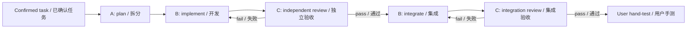

# A/B/C workflow / 协作流程

The [role reference](../skills/nativue/references/roles.md) is the maintained execution contract. The [Skill](../skills/nativue/SKILL.md) routes initialization, architecture analysis, and delivery. Do not keep an independent copy of role rules in project prompts.

[角色说明](../skills/nativue/references/roles.md)是流程的唯一维护来源；[Skill 入口](../skills/nativue/SKILL.md)负责初始化、架构分析及开发交付。项目提示词应链接到它，避免复制后失去同步。

## Example prompts / 示例指令

**A, manual / 手动模式：**

> Use Nativue as A. Plan local tasks P0 and P1 against the selected repository. Confirm ambiguous behavior, assign isolated work, and produce handoffs for separate B/C conversations. Keep integration and user acceptance pending until their evidence exists.

> 使用 Nativue，担任 A。处理选定仓库里的 P0、P1 本地任务，澄清含糊行为，分配隔离工作区，生成给独立 B/C 对话的交接包。集成与用户确认必须等实际证据。

**A, automatic / 自动模式：**

> Use Nativue as A in automatic mode for this confirmed batch. Detect your actual subagent and model-selection capabilities before dispatching. Keep B implementation and C acceptance independent. Return the integration commit and hand-test steps.

> 使用 Nativue 担任 A，以自动模式处理本批已确认任务。派工前检测实际子 Agent 和模型选择能力，B 开发与 C 验收使用独立上下文，最后交付集成提交及手测步骤。

**B or C / B 或 C：**

> Use Nativue as B (or C). Read the supplied handoff for task T-1, verify ownership and the exact version, and operate only within the assigned scope. Report evidence through the ledger.

> 使用 Nativue 担任 B（或 C）。读取 T-1 任务交接包，核对认领和准确版本，只在分配范围内工作，通过台账交回证据。
